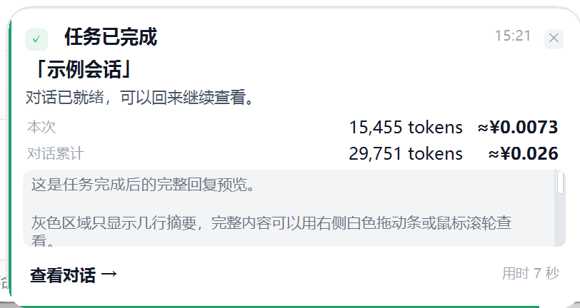
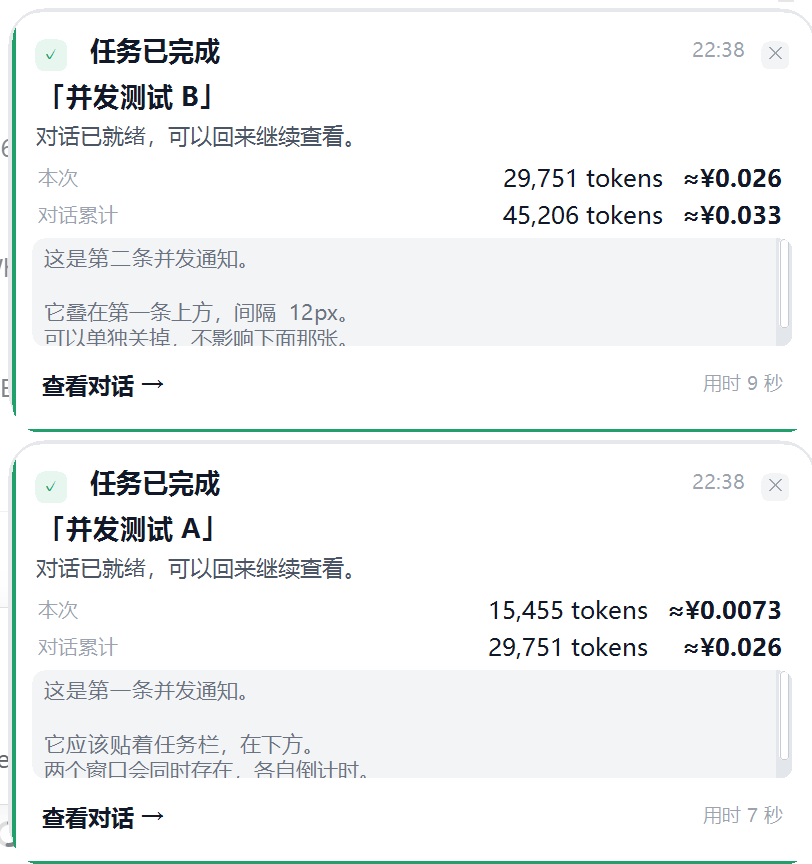

# dsh-task-toast · DSH 任务完成提醒

[](https://github.com/xxcxx2568/dsh-task-toast/actions/workflows/test.yml)
[](https://github.com/xxcxx2568/dsh-task-toast/releases)
[](LICENSE)

> GitHub：https://github.com/xxcxx2568/dsh-task-toast

Windows 上，DSH 一轮任务结束（`turn/end`）后，会在**屏幕右下角**弹出一个原生置顶卡片，盖在其他应用窗口上：

- **系统级置顶**：不是 DSH 网页内部浮层，切到浏览器/编辑器也能看到
- **本次 / 对话累计 token 与花费**：按 DeepSeek 官方峰谷价估算，显示在上方主区域
- **最终回复预览**：灰色区域只露出几行，右侧白色拖动条或滚轮可看完整内容
- **查看对话 →**：把 DSH 切到前台并跳到对应会话
- 底部绿色进度条走完**立即收起**；鼠标停在卡片上会暂停
- **同一时间最多两个通知上下堆叠**，各自独立计时/关闭/查看对话；第三个到来时最旧的一个让位
- 子代理结束不打扰；后台运行中的会话会临时保留引用
- UI 跟随 DSH 明暗主题



两个通知同时到达时，上下堆叠、各自计时：



非 Windows 平台，或原生窗口启动失败时，会自动回退为 DSH 网页内右下角卡片。

---

## 一、安装

### 依赖

- **Windows 10 / 11**：原生置顶窗口使用系统自带的 Windows PowerShell 5.1 + WinForms，不需要额外安装运行时
- **DSH**：带 Web UI 的当前版本（桌面版或 Web profile 均可）
- 插件本身**没有 npm 依赖**，不需要 API Key

macOS / Linux 不会启动原生窗口，会使用网页内卡片；功能仍可用。

### 方式一：DSH 插件管理页（推荐）

先把仓库克隆到本地任意目录：

```powershell
git clone https://github.com/xxcxx2568/dsh-task-toast.git
```

然后打开 DSH：

1. **插件 → 添加插件 → 本地目录**
2. 选择刚克隆的 `dsh-task-toast` 目录
3. 确认后**重启 DSH**（关闭窗口再打开）

### 方式二：命令行装进 profile

```powershell
git clone https://github.com/xxcxx2568/dsh-task-toast.git
cd dsh-task-toast
dsh plugin --profile web add "link:$PWD"
```

如果当前 DSH 支持 npm/git 规格，也可以直接：

```powershell
dsh plugin --profile web add "github:xxcxx2568/dsh-task-toast"
```

装完重启 DSH。桌面版 profile 由 Electron 托管，推荐直接用上面的「插件管理页 → 本地目录」。

### 安装后检查

- 「插件」页能看到 `dsh-task-toast`，并已启用
- 发一条普通消息，任务结束后右下角应出现置顶卡片
- 如果只出现网页内卡片，说明原生窗口没启动，查看下方「排障」

---

## 二、使用

正常发消息即可。任务结束时：

| 场景 | 标题 |
| --- | --- |
| 正常结束 | 任务已完成 |
| 执行报错 | 任务执行失败 |
| 用户停止 | 任务已停止 |
| DSH 中途退出 | 任务已中断 |
| 输出顶到上限 | 输出达到上限 |

卡片上可以：

- **滚轮 / 右侧白色拖动条**：查看灰色区域里的完整回复
- **点击 ×**：关闭；鼠标悬停会加深
- **查看对话 →**：聚焦 DSH 并跳到该会话
- 不操作时，底部绿色进度条走完立即收起；鼠标停在卡片上会暂停计时
- 同一时间最多两个窗口上下堆叠；第三个通知到来时，最旧的一个自动让位

子代理（subagent）结束**不会**弹窗，避免一个任务刷出一串通知；主对话结束时统一提醒。

---

## 三、Token 与花费

卡片上方显示两行：

```
本次        15,455 tokens    ≈¥0.0073
对话累计    29,751 tokens    ≈¥0.026
```

- **本次**：刚结束这一轮里所有模型调用的总量（含工具步骤、重试），来自 `assistant/message` / `assistant/attempt` 的 usage
- **对话累计**：优先读会话的 `tokenUsage` 投影（覆盖整份持久日志），读不到时退回插件启动后观察到的用量
- **花费**：按 DeepSeek 官方 2026-11 价格估算，币种 CNY，自动区分北京时间高峰/空闲：
  - `deepseek-flash`：缓存命中 ¥0.04 / 未命中 ¥2 / 输出 ¥8（每百万 token，高峰）；空闲 ¥0.02 / ¥1 / ¥4
  - `deepseek-v4-pro`：缓存命中 ¥0.30 / 未命中 ¥9 / 输出 ¥27（高峰）；空闲 ¥0.15 / ¥4.5 / ¥13.5
- 费用只按 token 估算，**不含** Search / Fetch 按次费用，也不处理法定节假日峰谷；它是提示，不是账单
- 未配置价格的模型显示 `—`，只展示 token；插件启动前的历史按当前模型/时段补算，切换模型时历史部分是近似值

价格来源：[DeepSeek 模型 & 价格](https://api-docs.deepseek.com/zh-cn/quick_start/pricing/)。

---

## 四、配置

在 DSH 页面按 F12，在 Console 执行后立即生效（不用重启）：

```js
// 关掉通知（系统置顶和网页内都关）
localStorage.setItem('dsh-task-toast.enabled', '0')
// 重新打开
localStorage.removeItem('dsh-task-toast.enabled')

// 自动消失时间（毫秒）。网页内默认 7000；系统置顶窗口最少 15000
localStorage.setItem('dsh-task-toast.duration', '20000')
```

### 给其他模型配价格

`dsh-task-toast.prices` 是「`provider/model` → 每百万 token 单价」JSON。可以补任意模型，也可以覆盖内置 DeepSeek 价格：

```js
localStorage.setItem('dsh-task-toast.prices', JSON.stringify({
  // 固定单价（不区分峰谷）
  "openai/gpt-5": {
    currency: "USD",
    input: 1.25,
    cacheRead: 0.125,
    cacheWrite: 1.25,
    output: 10
  },
  // 峰谷价
  "deepseek-account/deepseek-flash": {
    currency: "CNY",
    peak: { input: 2, cacheRead: 0.04, cacheWrite: 0, output: 8 },
    idle: { input: 1, cacheRead: 0.02, cacheWrite: 0, output: 4 }
  }
}))
```

删除这个 key 回到内置价格：

```js
localStorage.removeItem('dsh-task-toast.prices')
```

---

## 五、实现

| 半边 | 文件 | 作用 |
| --- | --- | --- |
| 浏览器 | `lib/client.js` | 监听 `turn/end`、算 token/花费；能力探测通过后 POST 给宿主；轮询“打开会话”动作 |
| 宿主 | `lib/index.js` | `/dsh-task-toast/api/{capabilities,notify,actions,dismiss}`；写状态文件并启动/回收置顶窗口 |
| 原生窗口 | `lib/overlay.ps1` | Windows PowerShell + WinForms：TopMost、屏幕右下角、RichTextBox 详情、自定义白色拖动条、自动消失 |

触发链路：

1. 通过 `ctx.sessions.list` 找到保留的会话，用 `ctx.sessions.binding(id)` 拿到 `binding.eventSource`，只处理 `append` 中的 `turn/start`、`assistant/message`、`turn/end`
2. `turn/end.data.reason.kind` 决定文案和颜色；`assistant/message` 的 text block 留作完整详情；`turn/start` 的时间用于算耗时
3. 用量按 `tokenUsage` 投影计算：attach 时读一次作为「插件启动前的历史」，之后 `assistant/message` / `assistant/attempt` 的 usage 按 turn/step 做「同一步替换、不同步累加」，`llm/retry-started` 时清空替换槽
4. 花费按 `provider/model` 查内置价或 `localStorage` 覆盖价；DeepSeek 按事件时间判断北京时间峰谷
5. 浏览器先请求 `/api/capabilities`；`systemOverlay: true` 时把标题、完整详情、统计文本和主题 POST 到 `/api/notify`，否则使用网页内卡片
6. 每条通知在 `%TEMP%\dsh-task-toast\popup-*` 独立目录写 state/action，并启动一个 `overlay.ps1 -Slot <0|1>` 窗口；最多两个上下堆叠，第三个到来时最旧窗口让位。窗口收起后自行退出，宿主回收目录
7. 置顶窗口的“查看对话”把 `{type:'open', sessionId}` 写入该窗口的 `action.json`；宿主汇总后由浏览器每 900ms 轮询 `/api/actions`，再调用 `ctx.uiWorkspace.openSession`

---

## 六、隐私与安全

- **不联网**：插件本身不向任何服务器上传数据；费用使用内置价目表估算
- **数据只在本地**：最终回复、会话标题、统计会短暂写到 `%TEMP%\dsh-task-toast\`，供本机原生窗口读取；插件停用/退出时清理
- **本地 HTTP 路由**只接受 loopback 请求；`/api/notify` 的内容不会离开本机
- **PowerShell 进程**：Windows 端会用 `powershell.exe -ExecutionPolicy Bypass` 启动仓库内的 `lib/overlay.ps1`，只负责画窗口和写动作文件；脚本可审计
- 仓库不包含 API Key、Cookie、本机绝对路径或任何真实会话数据；示例图使用虚构的「示例会话」

详见 [SECURITY.md](SECURITY.md)。

---

## 七、开发与测试

浏览器侧测试（不弹窗）：

```powershell
node tests/watcher.test.mjs
```

宿主侧测试（Windows，会短暂弹出原生窗口再清理）：

```powershell
node tests/host.test.mjs
```

语法检查：

```powershell
node --check lib/index.js
node --check lib/client.js
```

CI 在 Windows + Node 22 上跑浏览器侧测试和语法检查；宿主侧 GUI 测试需要可交互桌面，默认不在 CI 跑。

`lib/overlay.ps1` 必须保存为 **UTF-8 with BOM**，否则 Windows PowerShell 5.1 会按本地 ANSI 读取中文并解析失败。

---

## 八、排障

- **完全没有弹窗**：确认插件已启用；重启 DSH
- **只有网页内卡片**：原生窗口没启动。查看 `%TEMP%\dsh-task-toast\overlay.log`；确认 `C:\Windows\System32\WindowsPowerShell\v1.0\powershell.exe` 存在
- **右侧黑边/位置不对**：窗体与卡片右边缘已对齐；如果旧进程还在，重启 DSH 或结束 `overlay.ps1` 进程让宿主重新拉起
- **花费显示 `—`**：该模型不在内置价目表里，用上面的 `dsh-task-toast.prices` 补一条
- **累计 token 只有插件启动后的**：`tokenUsage` 投影不可用，卡片 tooltip 会注明；此时统计只覆盖观察范围
- **滚轮不动**：优先拖右侧白色拖动条；鼠标停在灰色区域上滚轮也可以

---

## 九、License

MIT，见 [LICENSE](LICENSE)。
